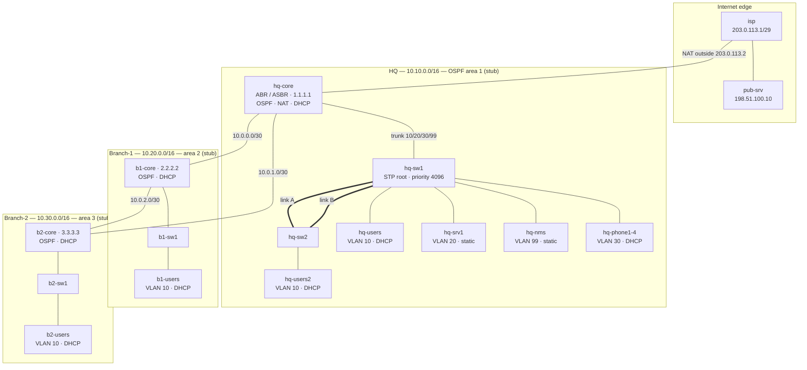

# Multi-Site Corporate Network Design with Fault Simulation

A three-site enterprise network  **HQ + Branch-1 + Branch-2** built with
**containerlab** and real **FRRouting** routers, plus four production-style
faults that are injected, detected, remediated and verified by an automated
`pytest` suite.

Everything is a container, so the whole network comes up from one YAML file and
is reproducible on any Linux box with Docker. No emulator, no screenshots: the
health checks and the incident scenarios are **assertions in code**.

```bash
make images && make deploy && make test
```

---

## Results

| Check | Result |
| --- | --- |
| `make baseline` — 30-point health check (OSPF, VLAN, NAT, DHCP, STP) | **30 passed, 0 failed** |
| `pytest tests/test_baseline.py` — baseline assertions | **12 passed** |
| `pytest tests/test_faults.py` — inject → detect → remediate → verify | **4 passed** |

Measured behaviour of each fault scenario:

| Scenario | Baseline | Faulted | After remediation |
| --- | --- | --- | --- |
| WAN link failure | `10.20.10.0/24` via `10.0.0.2` | OSPF drops to 1 neighbour, route moves to `10.0.1.2` (Branch-2) | adjacency back to `FULL`, primary path reinstalled |
| Routing loop | prefix absent | `traceroute` repeats the same 2 hops to the 8-hop limit | prefix unreachable again, normal traffic never affected |
| DHCP exhaustion | 4/4 phones leased | **3** of 4 leased, `no address available` in the server log | 4/4 leased, the starved phone recovers by itself |
| STP loop | 3 pps on the looped port, 1 port blocking | **262,299 pps** broadcast storm | 2 pps, one port blocking again |

Raw evidence for every run is written to `artifacts/`.

---

## Topology



19 nodes: 4 routers, 5 switches, 10 hosts.

Two deliberate design choices make the fault scenarios possible:

* **WAN triangle** (HQ↔B1, HQ↔B2, B1↔B2) — a WAN link failure has somewhere to
  reroute to, instead of being a dead end.
* **Two parallel links** between `hq-sw1` and `hq-sw2` — a real layer-2 loop, so
  STP has something to block and disabling it produces a real broadcast storm.

---

## Address plan

| Site | Aggregate | OSPF area | Router-ID |
| --- | --- | --- | --- |
| HQ | `10.10.0.0/16` | 1 (stub) | `1.1.1.1` |
| Branch-1 | `10.20.0.0/16` | 2 (stub) | `2.2.2.2` |
| Branch-2 | `10.30.0.0/16` | 3 (stub) | `3.3.3.3` |
| WAN transit | `10.0.0.0/22` | 0 | — |
| Internet edge | `203.0.113.0/29` | — | — |

| HQ VLAN | Subnet | Gateway | Addressing |
| --- | --- | --- | --- |
| 10 USERS | `10.10.10.0/24` | `10.10.10.1` | DHCP `.100–.150` |
| 20 SERVERS | `10.10.20.0/24` | `10.10.20.1` | static |
| 30 VOICE | `10.10.30.0/24` | `10.10.30.1` | DHCP `.100–.120` |
| 99 MGMT | `10.10.99.0/24` | `10.10.99.1` | static |

Full interface-by-interface plan: [`docs/addressing.md`](docs/addressing.md).

---

## Fault scenarios

Each scenario has a runbook (symptom → evidence → root cause → fix → verification)
and a matching automated test that performs the whole incident.

| # | Scenario | Runbook | Test |
| --- | --- | --- | --- |
| 1 | WAN link failure, reconvergence via the other branch | [01](docs/runbooks/01-wan-link-failure.md) | `test_wan_link_failure_reconverges_via_the_other_branch` |
| 2 | Static routing loop between two routers | [02](docs/runbooks/02-routing-loop.md) | `test_routing_loop_is_localised_and_removed` |
| 3 | DHCP scope exhaustion starving one device | [03](docs/runbooks/03-dhcp-exhaustion.md) | `test_dhcp_scope_exhaustion_and_scope_expansion` |
| 4 | STP loop → broadcast storm | [04](docs/runbooks/04-stp-loop.md) | `test_stp_loop_causes_a_broadcast_storm` |

Every test follows the same shape — **inject → detect → remediate → verify** — and
leaves the lab back in its baseline state:

```python
evidence = [run_script("faults/inject/wan_link_failure.sh")]
try:
    assert wait_until(lambda: ospf_neighbor_count(hq_core) <= 1, timeout=40)
    assert wait_until(lambda: route_via(hq_core, "10.20.10.0/24") == "10.0.1.2", timeout=90)
finally:
    evidence.append(run_script("faults/fix/wan_link_failure.sh"))
```

---

## Quickstart

**Requirements:** Linux, Docker, ~2 GB free disk. `containerlab` is installed by
`make install-clab` (pinned version) if it is missing.

```bash
# 1. tooling
python3 -m venv .venv && .venv/bin/pip install -r requirements-dev.txt

# 2. build the two node images (Alpine host/switch, FRR router)
make images

# 3. deploy the 19-node topology, then block until OSPF has fully converged
#    (make wait polls, it does not sleep for a fixed guess)
make deploy
make wait

# 4. prove the network is healthy (human-readable)
make baseline

# 5. run the full suite: baseline + all four fault scenarios
make test
```

Useful targets:

| Target | What it does |
| --- | --- |
| `make images` | Build `labnode` and `frrnode` |
| `make deploy` / `make destroy` / `make redeploy` | Manage the lab |
| `make wait` | Block until every router has two FULL OSPF neighbours |
| `make inspect` / `make graph` | containerlab topology views |
| `make baseline` | 30-point health check |
| `make test` | `pytest` — baseline + faults |
| `make fault NAME=stp_loop` / `make fix NAME=stp_loop` | Run one fault manually |
| `make lint` | shellcheck the scripts, validate the topology YAML |

Poking around by hand works too — every node is a container:

```bash
docker exec -it clab-corpnet-hq-core vtysh
docker exec clab-corpnet-hq-sw2 bridge link show
docker exec clab-corpnet-hq-core conntrack -L | grep 203.0.113.2
```

---

## How the lab is built

Two images, both with a `/etc/lab/setup.sh` boot hook:

| Image | Based on | Purpose |
| --- | --- | --- |
| `labnode` | Alpine | Hosts, access switches (Linux bridges with `vlan_filtering`), public server |
| `frrnode` | `quay.io/frrouting/frr:10.7.1` | Routers — real `ospfd`/`zebra`, plus dnsmasq, nftables, tcpdump, conntrack |

containerlab attaches the veth interfaces **after** the container starts, so
every node's boot hook waits for an interfaces-ready marker before touching the
network. That one detail is what makes the configs deterministic instead of a
race.

### Design decisions

| Decision | Reasoning |
| --- | --- |
| **containerlab + FRR** instead of Packet Tracer / GNS3 | Text topologies under version control, real Linux netns, runs in CI, no GUI |
| **OSPF with 4 areas** (backbone + 3 stubs) | Stub areas keep Type-5 LSAs out of the branches; the branches only need a default route |
| **nftables for NAT overload** | The upstream FRR build ships without NAT support (no `libnftnl`). nftables gives the same PAT behaviour with an inspectable conntrack table instead of a simulated command |
| **A DHCP server at each site** | Branch networks must survive a WAN outage for local address assignment. It also removes DHCP relay from the design entirely, and keeps the exhaustion scenario local to one site |
| **Faults as shell scripts + `pytest`** | A runbook you have to execute by hand is documentation. A runbook that *asserts* is a regression test |
| **Interface counters, not `tcpdump`, for the storm** | Capturing a storm means logging every frame before you can count them — slower than the storm. Reading `/sys/class/net/*/statistics` is O(1) |

### Things worth knowing

* Every fault script is idempotent-safe: `make fix` works even if the fault was
  half-applied, and each test restores the baseline in a `finally:` block.
* Baseline failures mean the **lab** is misconfigured; fault-test failures mean
  the **remediation** did not work. Keeping them in separate files keeps that
  distinction honest.
* `tests/lab.py` is the only place that talks to Docker, so the tests read as
  network intent rather than shell plumbing.

---

## Continuous integration

`.github/workflows/ci.yml` runs on every push and pull request, on a stock
`ubuntu-24.04` runner — no network simulator, no GUI, no pre-baked image:

```text
checkout → python tooling → install containerlab (pinned)
         → build labnode + frrnode → containerlab deploy
         → make wait   (poll until every router has 2 FULL neighbours)
         → make baseline   (30-point health check)
         → make test       (baseline + all four fault scenarios)
         → always: collect container logs, bridge/OSPF dumps, upload artifacts
         → always: tear the lab down
```

Two things this pipeline deliberately does *not* do:

* **No fixed `sleep`.** The wait step polls the control plane, so the job is
  neither flaky nor padded on a slower runner.
* **No hidden failures.** Teardown is best-effort (`|| true`) so a genuine test
  failure is what turns the job red, not a `containerlab destroy` with nothing
  left to destroy.

The evidence the tests write to `artifacts/` (route dumps, traceroutes, lease
tables, before/after packet rates) is uploaded whether the job passes or fails,
and on failure the runner also dumps every container log plus the switch bridge
and router OSPF state.

---

## Repository layout

```text
topology.clab.yml          the 19-node network, single source of truth
images/                    labnode (Alpine) and frrnode (FRR) build context
configs/                   per-node boot hooks, FRR configs, dnsmasq, nftables
faults/inject/  faults/fix/ the four fault scenarios and their remediations
tests/lab.py               docker-exec helpers (vtysh, ping, DHCP, counters…)
tests/test_baseline.py     what "healthy" means, as assertions
tests/test_faults.py       inject → detect → remediate → verify
scripts/baseline.sh        human-readable health check
docs/design.md             design goals, topology, routing/L2/services design
docs/addressing.md         complete IP plan and interface map
docs/runbooks/             one runbook per fault scenario
.github/workflows/ci.yml   deploy → converge → baseline → faults, with artifacts
artifacts/                 generated evidence (git-ignored)
```

---

## Limitations & next steps

* The ISP is a single router, so there is no BGP peering or dual-homing. A second
  upstream with BGP and a floating static route is the obvious extension.
* Failover relies on OSPF timers (hello 3s / dead 10s). BFD would cut detection
  to sub-second and is the first thing I would add for a production-grade setup.
* STP is a single instance spanning all VLANs. Per-VLAN (MSTP) or RSTP, plus
  BPDU guard and storm-control on access ports, would be the hardening step.
* DHCP failover between two servers is not modelled — the runbooks cover scope
  exhaustion, not server loss.
* No IPv6, no QoS for the voice VLAN, no AAA.
